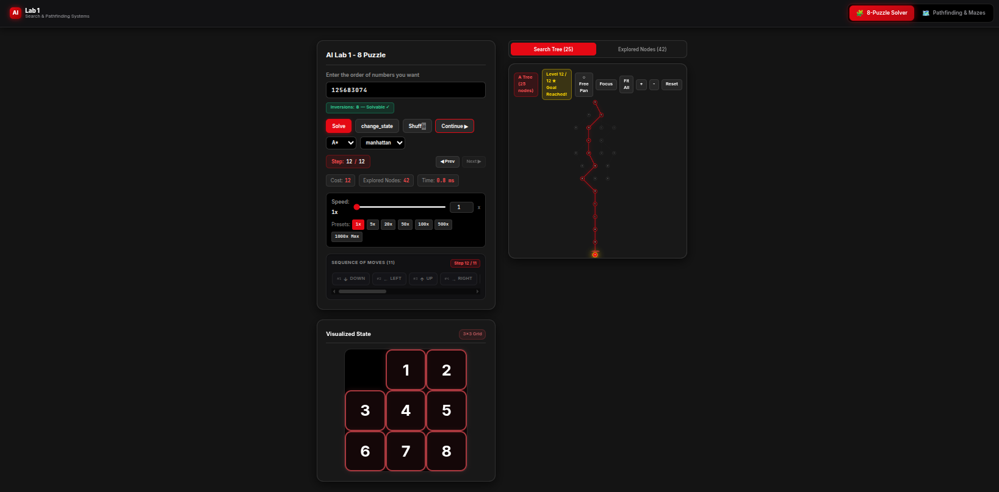
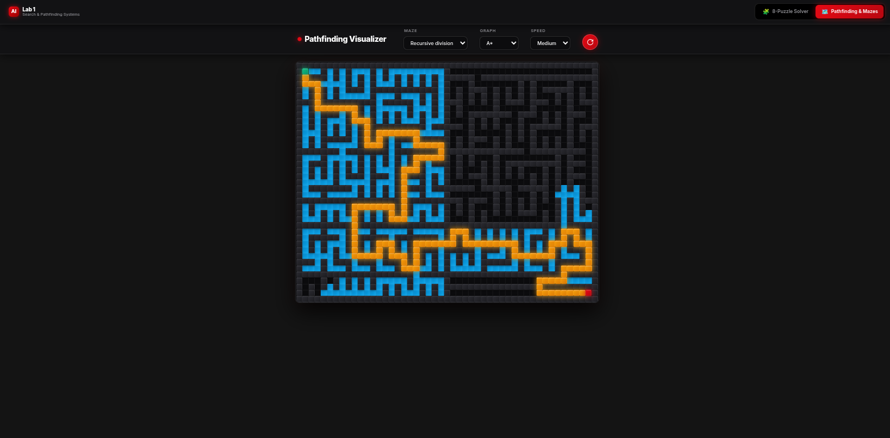

# AI Lab 1 — 8-Puzzle Solver & Pathfinding Visualizer

An interactive web application for visualizing classic AI search algorithms, split into two modules: an **8-Puzzle Solver** with search-tree exploration and a **Pathfinding & Maze Visualizer** with real-time animation.

---

## Previews

| 8-Puzzle Solver | Pathfinding & Maze Visualizer |
| :---: | :---: |
|  |  |

---

## Inspiration

The **Pathfinding & Maze Visualization** module was inspired by [this video](https://youtu.be/fLpvgCVYjTo?si=vA5TnikNGffZEbQt), which we wanted to develop and extend into a full interactive visualizer with multiple maze-generation and pathfinding algorithms.

---

## Features

### 8-Puzzle Solver

- Solve any solvable 8-puzzle configuration using **BFS**, **DFS**, **Iterative Deepening (IDFS)**, or **A\***
- Choose between **Manhattan** and **Euclidean** heuristics for A\*
- **Animated tile movement** with Framer Motion spring physics
- **Step-through playback** with adjustable speed (Slow / Medium / Fast / Instant)
- **Moves sequence panel** — clickable pills showing every move the solver took
- **Interactive search tree** — canvas-based visualization with pan & zoom
- **Explored nodes viewer** — paginated grid of all explored states with search
- **Solvability check** via inversion count before solving
- Real-time stats: steps, cost, time taken, explored nodes, tree size

### Pathfinding & Maze Visualizer

- **Maze generation algorithms:** Binary Tree, Recursive Division (horizontal & vertical bias)
- **Pathfinding algorithms:** BFS, DFS, Dijkstra, A\*
- Drag-to-place walls and reposition start/end tiles
- Real-time traversal animation with adjustable speed
- Responsive grid with dark-themed UI

### General

- **Mode switcher** — seamless toggle between the two modules via a segmented pill control
- Fully dark-themed UI with a cohesive color palette

---

## Tech Stack

| Layer | Technologies |
| --- | --- |
| **Frontend** | React 19, TypeScript 7, Vite 8, Tailwind CSS 4, Framer Motion, Axios, react-icons |
| **Backend** | Python, FastAPI, Uvicorn |
| **Algorithms** | BFS, DFS, IDFS, A\* (puzzle); BFS, DFS, Dijkstra, A\* (pathfinding); Binary Tree, Recursive Division (maze gen) |

### Color Palette

| Role | Color |
| --- | --- |
| Neutral / Background | `#141414` |
| Primary / Accent | `#E50914` |
| Secondary | `#000000` |

---

## Project Structure

```
Lab1/
├── Backend/                        # Python FastAPI server
│   ├── api.py                      # FastAPI app — POST /solve endpoint
│   ├── main.py                     # CLI entry point for the solver
│   ├── Search.py                   # BFS, DFS, IDFS, A* implementations
│   ├── Models.py                   # Node class (state, move, parent, depth, cost)
│   ├── Heuristics.py               # Manhattan & Euclidean distance functions
│   ├── Dto.py                      # Pydantic request/response models
│   └── solvingWrapper.py           # Wrapper utilities for the solver
│
├── frontend/                       # React + Vite application
│   ├── package.json
│   ├── vite.config.ts
│   ├── tailwind.config.js
│   └── src/
│       ├── main.tsx                # React entry point
│       ├── App.tsx                 # Root component — mode switcher
│       ├── App.css                 # App-level styles & mode switcher pill
│       ├── index.css               # Global styles, Tailwind directives, fonts
│       │
│       ├── models/
│       │   └── Dto_models.ts       # TypeScript interfaces mirroring backend DTOs
│       │
│       ├── services/
│       │   └── servicesHandler.ts  # Axios client — calls POST /solve
│       │
│       ├── components/             # ── 8-Puzzle Module ──
│       │   ├── Board/
│       │   │   ├── Board.tsx       # Main orchestrator — layout, solve logic,
│       │   │   │                   #   step-through playback, state management
│       │   │   └── Board.css       # Two-column grid layout (control+board │ tree)
│       │   │
│       │   ├── ControlPanel/
│       │   │   ├── ControlPanel.tsx # State input, algorithm/heuristic selectors,
│       │   │   │                    #   solve/reset/step buttons, speed slider,
│       │   │   │                    #   inversion counter, moves sequence panel
│       │   │   └── ControlPanel.css # Control panel dark-themed styling
│       │   │
│       │   ├── Tiles/
│       │   │   ├── Tile.tsx        # Single puzzle tile — Framer Motion spring
│       │   │   │                   #   animation, correct-position highlighting
│       │   │   └── Tile.css        # Tile sizing, colors, transitions
│       │   │
│       │   ├── ExploredNodes/
│       │   │   ├── ExploredNodes.tsx # Paginated explored-states viewer with search
│       │   │   └── ExploredNodes.css # Grid layout for state cards
│       │   │
│       │   └── SearchTree/
│       │       ├── SearchTree.tsx   # Interactive canvas tree — pan, zoom, focus
│       │       └── SearchTree.css   # Canvas container styling
│       │
│       └── Pathfinding_Part/       # ── Pathfinding & Maze Module ──
│           ├── pathfinding.css      # Full dark-theme styles for the pathfinding UI
│           │
│           ├── PathFindingComponents/
│           │   ├── Grid.tsx         # Responsive tile grid with drag interactions
│           │   ├── Nav.tsx          # Top navigation bar (algorithm/maze selectors)
│           │   ├── PlayButton.tsx   # Run / reset animation control
│           │   ├── Select.tsx       # Dropdown select component
│           │   └── tile.tsx         # Individual grid tile (wall/start/end/visited/path)
│           │
│           ├── context/
│           │   ├── PathfindinContext.tsx  # Grid state & algorithm context
│           │   ├── SpeedContext.tsx       # Animation speed context
│           │   └── TileContext.tsx        # Tile interaction context
│           │
│           ├── hooks/
│           │   ├── usePathfinding.tsx     # Grid initialization & algorithm runner
│           │   ├── useSpeed.tsx           # Speed state hook
│           │   └── UseTile.tsx            # Tile drag & interaction hook
│           │
│           ├── lib/algorithms/
│           │   ├── maze/
│           │   │   ├── binaryTree.ts          # Binary Tree maze generation
│           │   │   ├── recursiveDivision.ts   # Recursive Division maze generation
│           │   │   ├── horizontalDivision.ts  # Horizontal-bias division
│           │   │   └── verticalDivision.ts    # Vertical-bias division
│           │   │
│           │   └── pathfinding/
│           │       ├── aStar.ts       # A* search with heuristic
│           │       ├── bfs.ts         # Breadth-First Search
│           │       ├── dfs.ts         # Depth-First Search
│           │       └── dijkstra.ts    # Dijkstra's algorithm
│           │
│           └── utils/
│               ├── constants.ts              # Grid dimensions, speed presets
│               ├── types.ts                  # TypeScript type definitions
│               ├── helpers.ts                # General utility functions
│               ├── createWall.ts             # Wall creation logic
│               ├── destroyWall.ts            # Wall removal logic
│               ├── constructBorder.ts        # Grid border construction
│               ├── resetGrid.ts              # Grid state reset
│               ├── runMazeAlgorithm.ts       # Maze algorithm dispatcher
│               ├── runPathFindingAlgorithm.ts # Pathfinding algorithm dispatcher
│               ├── animatePath.ts            # Path traversal animation
│               ├── heuristics.ts             # Heuristic functions for A*
│               ├── getUntraversedNeighbours.ts # Neighbour discovery
│               └── isInQueue.ts              # Priority queue membership check
│
├── preview/                        # Screenshot previews (add your own)
│   ├── puzzle-preview.png
│   └── pathfinding-preview.png
│
└── README.md                       # ← You are here
```

---

## Getting Started

### 1. Start the Backend

```bash
cd Backend
pip install fastapi uvicorn pydantic
python api.py
# Server runs on http://localhost:8080
```

### 2. Start the Frontend

```bash
cd frontend
npm install
npm run dev
# App opens on http://localhost:5173
```

### 3. Use the App

1. Use the **mode switcher** at the top to toggle between the 8-Puzzle Solver and the Pathfinding Visualizer.
2. **8-Puzzle:** Enter a comma-separated initial state (e.g. `1,2,5,3,4,0,6,7,8`), pick an algorithm, and hit **Solve**. Step through the solution or watch it animate automatically.
3. **Pathfinding:** Select a maze algorithm to generate walls, then pick a pathfinding algorithm and press **Play** to watch the traversal.

---

## Algorithms

### 8-Puzzle Solver

| Algorithm | Description |
| --- | --- |
| **BFS** | Breadth-First Search — guarantees shortest path, explores level by level |
| **DFS** | Depth-First Search — explores as deep as possible before backtracking |
| **IDFS** | Iterative Deepening DFS — combines DFS space efficiency with BFS completeness |
| **A\*** | Informed search using Manhattan or Euclidean heuristic — optimal and efficient |

**Goal state:** `[[0,1,2],[3,4,5],[6,7,8]]`  
**Solvability:** Determined by inversion count (even → solvable).

### Pathfinding

| Algorithm | Description |
| --- | --- |
| **BFS** | Unweighted shortest path via level-order exploration |
| **DFS** | Explores one branch fully before trying alternatives |
| **Dijkstra** | Weighted shortest path (uniform cost on this grid) |
| **A\*** | Heuristic-guided search for faster optimal pathfinding |

### Maze Generation

| Algorithm | Description |
| --- | --- |
| **Binary Tree** | Each cell carves a passage north or east — fast, biased mazes |
| **Recursive Division** | Recursively splits the grid with walls and carves passages — balanced mazes |

---
